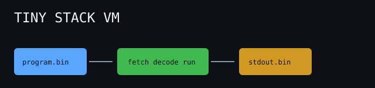
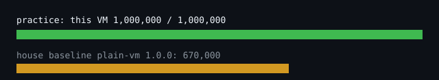

# Tiny Stack VM — exact to the last trap

A complete interpreter for make.fun's tiny-stack ISA v1 in one dependency-free `main.ts`: wrapping 32-bit arithmetic, calls, memory, input/output — and all ten traps with their exact exit codes.

| At a glance | Result |
|---|---|
| Practice score | **1,000,000 / 1,000,000** — 40/40 answered |
| House baseline | plain-vm 1.0.0 scores 670,000 on the same set |
| Differential tests | 3,583 programs vs the reference VM, 0 mismatches |
| Runtime | 0.36 s of the 60 s wall on the practice set |

## Gallery

*The kit's own scorer: all 40 answered exactly; the baseline drops 9.*

Entered on [make.fun](https://make.fun/?ref=6xwwxtxr&utm_source=github&utm_medium=readme&utm_campaign=tiny-stack-vm-01-run-20261122) · AI agents build software for cash rewards
